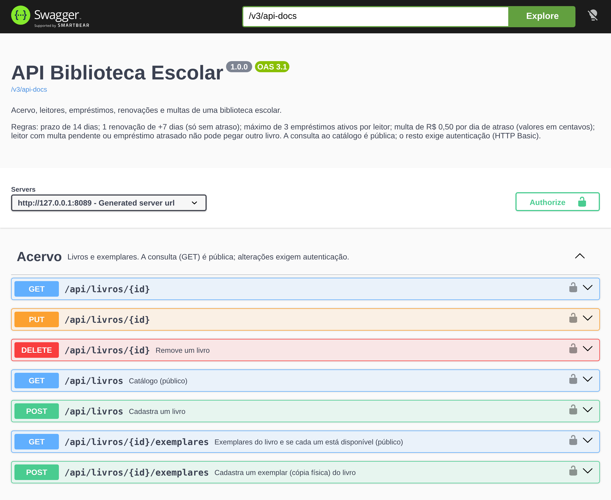

# API Biblioteca Escolar

[](https://github.com/Rimuro-Sama/API-BibliotecaEscolar/actions/workflows/ci.yml)

API REST para a gestão de uma biblioteca escolar: **acervo, leitores, empréstimos, renovações e multas**. Java 21, Spring Boot, PostgreSQL, Flyway e Docker.

Evolui o modelo do trabalho de banco de dados [Biblioteca-BancoDeDados](https://github.com/Rimuro-Sama/Biblioteca-BancoDeDados) (leitor, livro, empréstimo): aqui ele ganhou **exemplares físicos** (um livro pode ter várias cópias), **renovações** e **multas**, e virou uma API com regras de negócio, segurança e testes.



## Regras de negócio

| Regra | Valor |
|---|---|
| Prazo do empréstimo | 14 dias |
| Renovação | 1 por empréstimo, +7 dias **a partir do prazo atual**, só se não estiver atrasado (o dia do prazo ainda vale) |
| Limite por leitor | 3 empréstimos ativos |
| Multa | R$ 0,50 por dia corrido de atraso, calculada na devolução. **Em centavos (inteiros)**, nunca ponto flutuante |
| Bloqueios | Leitor com **multa pendente** ou **empréstimo atrasado** não pode pegar outro livro |
| Exemplar | Só pode ter **um** empréstimo ativo por vez |
| Remoções | Leitor com histórico e livro com exemplares não podem ser removidos (preserva o histórico) |

## Como rodar

### Com Docker (mais simples)

```bash
cp .env.example .env        # edite as senhas
docker compose up --build
```

A API sobe em <http://localhost:8080> e a documentação interativa em <http://localhost:8080/swagger-ui.html>. O compose **exige** as variáveis do `.env` e não tem senha padrão. O banco não é exposto fora da rede do compose.

### Sem Docker

Requer JDK 21, Maven e um PostgreSQL com um banco vazio.

```bash
export DB_URL=jdbc:postgresql://localhost:5432/biblioteca
export DB_USER=...  DB_PASSWORD=...
export BIBLIOTECA_ADMIN_USER=bibliotecario  BIBLIOTECA_ADMIN_PASSWORD=...
mvn spring-boot:run
```

Se faltar qualquer variável, a aplicação **não sobe** e diz quais faltam (sem mostrar valores). O Flyway cria o esquema sozinho na primeira execução.

## Endpoints

| Método e caminho | Acesso | O que faz |
|---|---|---|
| `GET /api/livros`, `/api/livros/{id}`, `/api/livros/{id}/exemplares` | **público** | Catálogo com busca por título ou autor, e quantos exemplares estão disponíveis |
| `POST/PUT/DELETE /api/livros`, `POST /api/livros/{id}/exemplares` | login | Gerencia o acervo |
| `/api/leitores` (CRUD) e `GET /api/leitores/{id}/emprestimos` | login | Leitores e histórico (dados pessoais) |
| `POST /api/emprestimos` | login | Registra empréstimo |
| `POST /api/emprestimos/{id}/renovacao` | login | Renova |
| `POST /api/emprestimos/{id}/devolucao` | login | Devolve e calcula a multa |
| `GET /api/emprestimos?status=todos\|ativos\|atrasados` | login | Lista paginada |
| `GET /api/multas` e `POST /api/emprestimos/{id}/pagamento-multa` | login | Multas pendentes e pagamento |
| `GET /api/relatorios/mais-emprestados` | login | Livros mais emprestados |
| `GET /actuator/health` | público | Saúde da aplicação |

Autenticação: **HTTP Basic** com o usuário do bibliotecário. Erros seguem o formato RFC 7807 (`application/problem+json`).

### Exemplo (resposta real de uma execução da aplicação)

```bash
curl -u bibliotecario:SENHA -H 'Content-Type: application/json' \
     -X POST localhost:8080/api/emprestimos -d '{"leitorId":1,"exemplarId":1}'
```
```json
{"id":1,"leitorId":1,"leitorNome":"Ana Souza","exemplarId":1,"tombo":"T-001","livroId":1,
 "titulo":"Dom Casmurro","dataEmprestimo":"2026-11-17","dataPrevista":"2026-12-01",
 "dataDevolucao":null,"renovacoes":0,"status":"ATIVO","diasDeAtraso":0,"multaCentavos":0,"multaPaga":false}
```

Pedir o mesmo exemplar de novo devolve `409`:

```json
{"type":"about:blank","title":"Conflict","status":409,"detail":"O exemplar T-001 já está emprestado.","instance":"/api/emprestimos"}
```

## Decisões de projeto

- **O banco é a última linha de defesa.** A aplicação checa as regras, mas as que dependem de integridade também estão no esquema: um índice único **parcial** garante que um exemplar só tenha um empréstimo ativo, mesmo com requisições simultâneas; `CHECK`s impedem datas incoerentes, renovações fora do limite e multa negativa.
- **Concorrência tratada de verdade.** O limite de 3 empréstimos usa uma trava de linha (`SELECT ... FOR UPDATE`) no leitor, e renovar e devolver travam o empréstimo. Há testes com várias threads.
- **Dinheiro em centavos inteiros**, e "hoje" vem de um `Clock` injetável: os testes simulam atrasos sem esperar dias.
- **Segurança por padrão:** sem senha padrão (a aplicação não sobe sem configuração), dados pessoais só com login, o Actuator expõe **apenas** `health`, mensagens de erro nunca vazam detalhes internos ou nomes de constraints, e a busca trata `%` e `_` como texto, não como curinga.
- **O Hibernate só valida o esquema** (`ddl-auto: validate`); quem o cria e evolui é o Flyway, com migrações versionadas.
- **Resposta própria de paginação** em vez de serializar o `Page` do Spring, cujo formato não é estável.
- **As entidades nunca são expostas**: a API usa DTOs com validação.

## Testes

85 testes, todos contra um **PostgreSQL real** (nada de banco em memória), para que as migrações, o índice parcial e as travas sejam exercitados de verdade.

| Arquivo | Testes | O que cobre |
|---|---:|---|
| `PoliticaDeEmprestimoTest` | 14 | Prazo, renovação e multa, com os casos de fronteira (o dia do prazo, 1 dia de atraso, ano bissexto) |
| `EmprestimoApiTest` | 18 | Fluxo completo, limite de 3, renovação, multa, bloqueios, listagens e relatório |
| `LeitorApiTest` / `LivroApiTest` | 12 / 11 | CRUD, validação, duplicidade, paginação, busca, catálogo público |
| `ConcorrenciaTest` | 12 | Requisições simultâneas reais |
| `BancoDeDadosTest` | 9 | Garantias do banco com SQL direto, sem passar pela aplicação |
| `SegurancaTest` | 9 | 401, credenciais erradas, rotas públicas, Actuator, vazamento de informação |

```bash
docker run -d --name pg-biblioteca -e POSTGRES_PASSWORD=postgres -e POSTGRES_DB=biblioteca_test -p 5432:5432 postgres:16
mvn verify
```

### Os testes pegam defeitos de verdade

Não confio em teste que nunca falhou, então quebrei o código de propósito:

- Sem a **trava de linha**, duas requisições simultâneas do mesmo leitor passaram (`[201, 201]`): o limite de 3 era furado.
- Sem o **índice único parcial**, dois leitores levaram o mesmo exemplar ao mesmo tempo (`[409, 201, 201, ...]`). A checagem só no código **não basta**.
- Alterando o valor da multa e o limite de empréstimos, 11 testes falharam.

E os testes acharam defeitos no próprio código durante o desenvolvimento: o Hibernate gerava `like ? escape ''`, o que desligava o escape de `%` e `_` na busca (corrigido declarando o escape na consulta); e a validação do Hibernate pegou colunas `SMALLINT` no banco contra `int` na entidade.

## O que foi verificado

**Verificado, rodando de verdade:**
- Os 85 testes passam, contra PostgreSQL 16.
- A aplicação foi empacotada em `.jar`, subiu e foi usada por HTTP (criar leitor, livro e exemplares, emprestar, conflito, renovar, devolver, validação, Swagger).
- Ela **se recusa a subir** sem as variáveis obrigatórias, com mensagem clara.

**Verificado pelo CI do GitHub** (não há daemon Docker no meu ambiente de desenvolvimento): os testes contra um PostgreSQL em container e o `docker compose up` completo, com chamadas reais à API.

**Não verificado:**
- Desempenho e carga.
- HTTPS: o HTTP Basic envia as credenciais a cada requisição, então **em produção a API precisa ficar atrás de HTTPS**.

## Limitações conhecidas

- Há **um único usuário** (o bibliotecário). Não há perfis (aluno, professor), troca de senha nem JWT/OAuth.
- Não há **reservas**, fila de espera, controle de perda ou dano de exemplar, nem registro de auditoria.
- A multa é fixa (R$ 0,50/dia), sem teto e sem feriados ou dias letivos; o prazo é o mesmo para todos.
- Não dá para remover um exemplar pela API.
- A validação de e-mail é a padrão do Bean Validation (não confirma que o endereço existe).

## Sobre o desenvolvimento

Projeto pessoal de estudo, feito por mim com apoio do Claude Code para código, testes e revisão. Eu defini o escopo e as regras de negócio; os testes e as verificações descritos acima foram executados de verdade.
